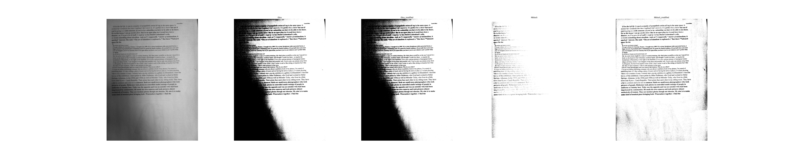
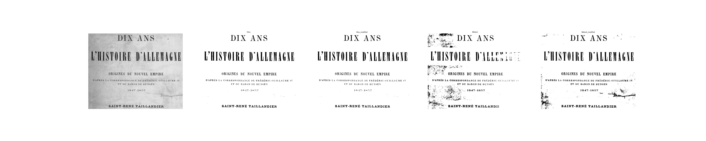
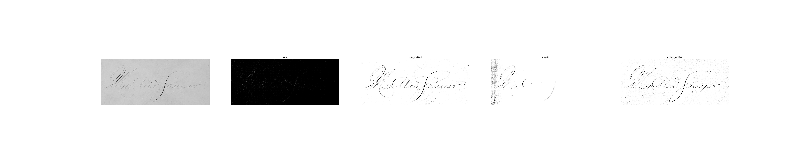
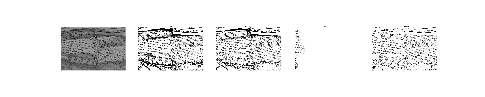
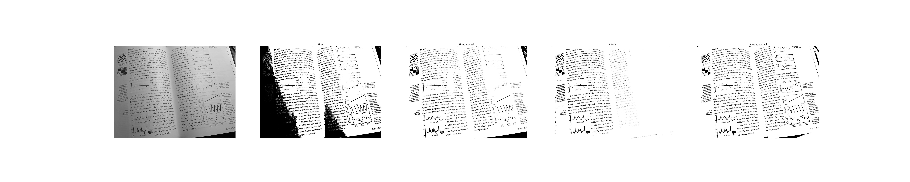
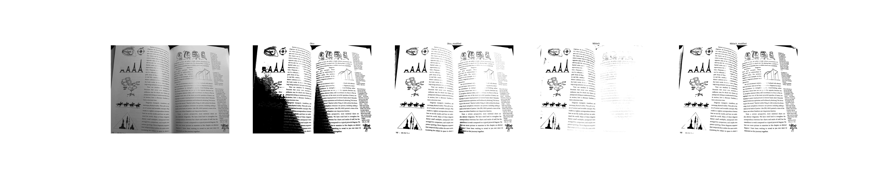
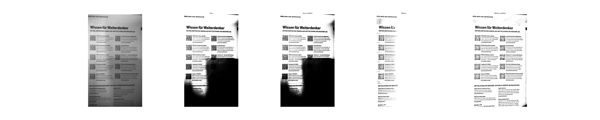
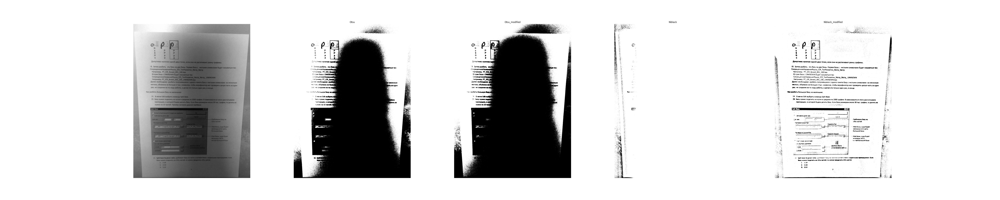
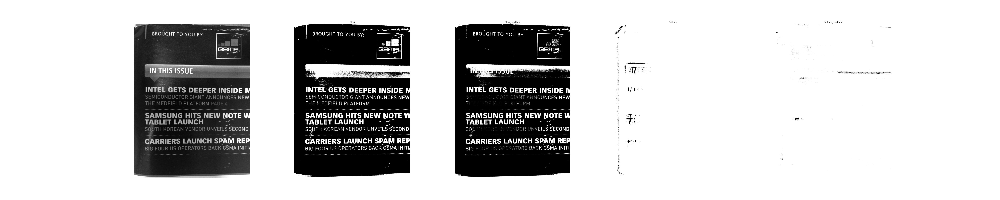

# Image Binarization Results

This repository contains **only the results** of applying four binarization algorithms to a test image dataset. No source code is included.

## Algorithms Used
The folders present the processing results of the following methods:
1. **Classic global Otsu's method**
2. **Unbalanced modification of Otsu's criterion** (for cases where *a priori* class weights of the object and background are not equal)
3. **Local Niblack's algorithm** (threshold function \(T(x,y) = \mu(x,y) + \alpha \sigma(x,y)\))
4. **Multi-scale modification of Niblack's algorithm** (proposed by V. Postnikov)

## Dataset
The processing was performed on a test set of **20 diverse grayscale images**. 

*Note:* Full-color (multi-channel) images were intentionally not processed.

# Binarization

